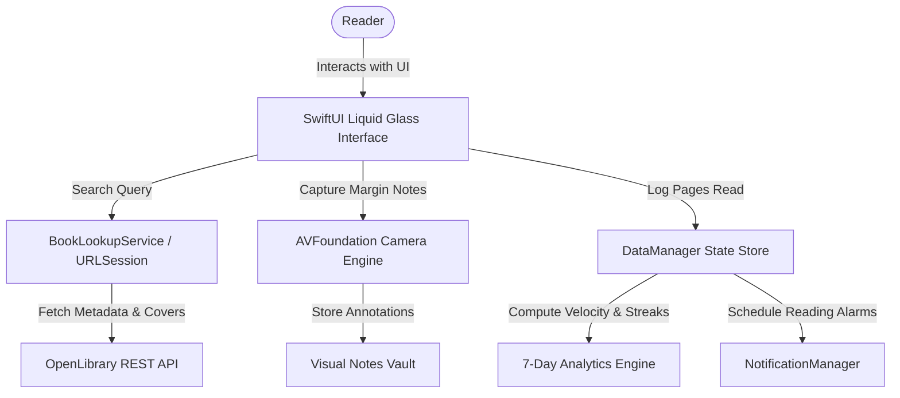

# Shelfwise (iOS) — Intelligent Curriculum & Visual Reading Tracker 📚

[](https://developer.apple.com/ios/)
[](https://swift.org/)
[](https://developer.apple.com/xcode/swiftui/)
[](https://developer.apple.com/documentation/combine)
[](https://developer.apple.com/av-foundation/)
[](https://openlibrary.org/developers/api)
[](LICENSE)

> **Shelfwise** is an intelligent reading companion and curriculum tracker built natively for iOS with **Swift**, **SwiftUI**, **Combine**, and **AVFoundation**. It combines real-time book metadata discovery via the **OpenLibrary API**, an encrypted **AVFoundation-based Visual Notes Vault**, a **7-day habit analytics dashboard**, and a bespoke **Liquid Glass dark-mode UI**.

---

## 🌟 Key Highlights

- **Intelligent Curriculum Engine**: Structured multi-level reading paths spanning Cognitive Psychology, Mental Models, Behavioural Economics, and Subconscious Processes.
- **OpenLibrary API Integration**: Asynchronous title, author, cover, page count, and key insight lookup (`BookLookupService`) with automatic metadata fallback and topic classification.
- **AVFoundation Visual Notes Vault**: Capture book annotations, margin notes, and physical page excerpts directly into an organized visual vault (`CameraView` & `PhotoNotesView`).
- **7-Day Analytics & Velocity Dashboard**: Interactive reading streak tracking, daily page metrics, topic completion ratios, and reading habit insights (`WeeklyReportView`).
- **Custom Liquid Glass Dark UI**: Glassmorphic styling, neon accent gradients, and smooth interactive spring animations designed for deep focus (`Theme.swift`).

---

## 🏗️ System Architecture



---

## 🚀 Feature Details

### 1. Intelligent Curriculum Catalog
- Guided progression through curated psychology and self-mastery topics.
- Tracks reading milestone percentages per subject topic.
- Dynamic custom book addition with tag and curriculum binding.

### 2. OpenLibrary Network Client
- Queries `openlibrary.org/search.json` with rate-limiting, error recovery, and image caching.
- Extracts author details, published editions, and high-resolution cover artwork.

### 3. AVFoundation Visual Notes Vault
- Custom hardware camera session management with real-time preview and flash controls.
- Tag visual excerpts by chapter, page number, and key quote takeaways.

### 4. 7-Day Velocity & Habit Dashboard
- Daily reading streaks with completion rings.
- Visual breakdown of pages logged versus weekly reading targets.

---

## 📂 Project Structure

```
Shelfwise/
├── Shelfwise.xcodeproj/           # Xcode Project
├── book_covers/                   # High-res curated cover assets
└── Shelfwise/
    ├── MyApp.swift                # App entrypoint
    ├── Models.swift               # Data models & Psychology topics
    ├── DataManager.swift          # Core data controller & persistence
    ├── BookLookupService.swift    # OpenLibrary API client
    ├── Theme.swift                # Glassmorphic Liquid Glass design tokens
    ├── ContentView.swift          # Root navigation & tab bar
    ├── BookCardView.swift         # Fluid book cover cards
    ├── BookDetailView.swift       # Reading status & chapter milestones
    ├── CurriculumCatalog.swift    # Structured curriculum definitions
    ├── CurriculumView.swift       # Topic roadmap & skill tracking
    ├── CameraView.swift           # AVFoundation camera capture
    ├── PhotoNotesView.swift       # Visual notes gallery & notes vault
    ├── WeeklyReportView.swift     # 7-day analytics charts
    ├── NotificationManager.swift  # Reading reminder dispatcher
    └── Assets.xcassets/           # Colors and app assets
```

---

## 🛠️ Building & Running

### Requirements
- macOS Sonoma or Sequoia
- Xcode 15.0+ or Xcode 16+
- iOS 17.0+ Simulator or physical device

### Steps
1. Clone the repository:
   ```bash
   git clone https://github.com/Dk043131/shelfwise.git
   cd shelfwise
   ```
2. Open the project in Xcode:
   ```bash
   open Shelfwise.xcodeproj
   ```
3. Select an iOS 17+ Simulator or your connected iPhone.
4. Press `Cmd + R` to build and run.

---

## 📄 License
This project is open-source under the [MIT License](LICENSE).
